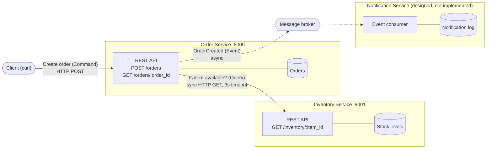
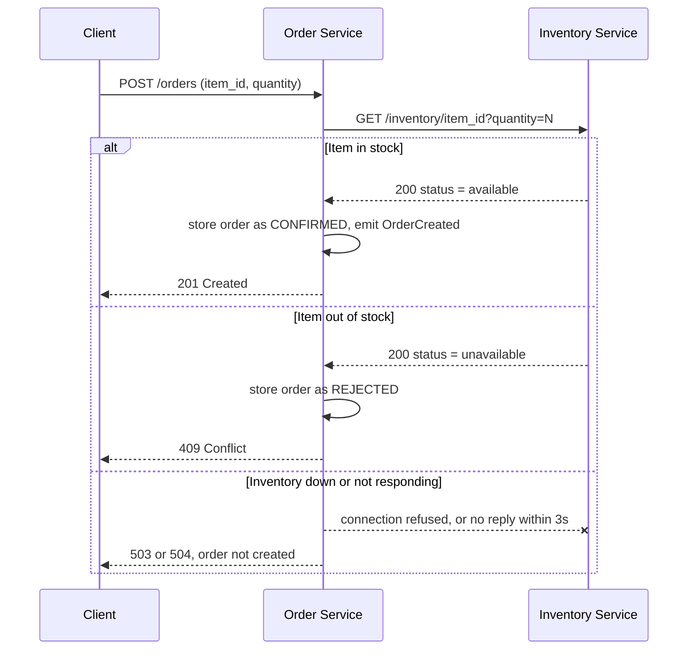

# Module 4 Assignment

The **Order Service** and the **Inventory Service** run as independent Python (Flask) processes and talk over HTTP. When an order is submitted, the Order Service asks the Inventory Service whether the item is available. It then confirms or rejects the order, and it fails cleanly if the Inventory Service is down.


---

## 1. Installing and running

**Prerequisites:** Python 3.9+ (tested with Python 3.13) and `curl`.

```bash
# from the repository root
python -m venv .venv

# activate it (macOS / Linux)
source .venv/bin/activate
# activate it (Windows PowerShell)
.venv\Scripts\Activate.ps1

pip install -r requirements.txt
```

Start each service in **its own terminal**:

```bash
# Terminal 1: Inventory Service
python inventory_service/app.py      # listens on http://127.0.0.1:8001

# Terminal 2: Order Service
python order_service/app.py          # listens on http://127.0.0.1:8000
```

Submit an order from a third terminal:

```bash
curl -i -X POST http://127.0.0.1:8000/orders \
  -H "Content-Type: application/json" \
  -d '{"item_id": "keyboard", "quantity": 2}'
```

To run the failure test, press **Ctrl+C** in Terminal 1 to stop the Inventory Service, then submit another order.


### Sample inventory data

The Inventory Service keeps this in memory:

| item_id | units in stock |
|---|---|
| `keyboard` | 10 |
| `mouse` | 25 |
| `headphones` | 2 |
| `monitor` | 0 (always unavailable) |

---

## 2. Architecture



Each service keeps its own data store. No database is shared, and the only way to reach another service's data is through that service's API.

### Order submission flow



### Component responsibilities

- **Order Service** accepts order submissions, decides whether each order is confirmed or rejected, records it, and lets clients look orders up. It is the only entry point for creating an order. It announces confirmed orders with an `OrderCreated` event.
- **Inventory Service** tracks how many units of each item are in stock and answers "is this quantity of this item available?" It knows nothing about orders or customers.
- **Notification Service** (designed only) listens for `OrderCreated` events and notifies the customer by email, SMS, etc. It reacts to orders but never creates or changes them.

### Data ownership

| Service | Owns (source of truth) | Does **not** own; how it gets it instead |
|---|---|---|
| **Order** | Orders: `order_id`, `item_id`, `quantity`, `status` (`CONFIRMED` / `REJECTED`), `created_at` | Stock levels: asks Inventory through `GET /inventory/:item_id` |
| **Inventory** | Stock per item (`item_id` → units on hand) and the rule for what counts as "available" | Orders: never sees them, only answers availability questions |
| **Notification** | Notification records (what was sent, to whom, when, delivery status), message templates, customer notification preferences | Order details: receives them in the `OrderCreated` event payload |

### Explanation for service boundaries

- **One business capability per service, each with its own reason to change.** Restocking or adding warehouses changes only Inventory. Adding cancellations or refunds changes only Order. Switching from email to SMS changes only Notification.
- **One owner for each piece of data.** The Order Service cannot read the stock table. It has to ask. Inventory is therefore free to change how it stores stock or computes availability (reservations, multiple warehouses) without breaking the Order Service, as long as its API stays the same.
- **The communication style matches how tightly the services depend on each other.** Order *needs* the availability answer before it can reply to the customer, so that call is a synchronous query. A notification is a side effect the customer doesn't wait for, so it is an asynchronous event. A Notification outage can never slow down or fail order creation.
- **Failures stay contained.** Losing Inventory blocks new orders only. The Order Service stays up and keeps serving its own data. The failure test below shows `GET /orders/:order_id` still working while Inventory was down.
- **Not split any further.** Each of the three assignment responsibilities maps to one capability with its own data. Splitting further would add network hops without adding independent ownership.

---

## 3. Command, Query, and Event

| Interaction | Type | Why |
|---|---|---|
| **Check whether an item is available** | **Query** | It asks for information and changes nothing. Inventory only reads stock on this path, so it can be repeated any number of times with no side effects. It returns an answer (`available` / `unavailable`) and is implemented as an HTTP `GET`. |
| **Create an order** | **Command** | It is a request to *change state* (create a new order), sent to the one service that owns orders. A command can be **rejected** (item unavailable, invalid input, Inventory down), and the caller waits to learn the outcome. It is implemented as an HTTP `POST`. |
| **Order was created** | **Event** | It is a **past-tense fact** about something that already happened, so receivers cannot reject it. It is broadcast: the Order Service doesn't know or care who listens (Notification today, maybe Analytics later). It is published asynchronously after the order is stored, so the Order Service never waits for consumers. |

---


## 4. Demo

Everything below was captured from one run with both services started as separate processes, as described in section 1.

### 4.1 Successful request

```
$ curl -s -i -X POST http://127.0.0.1:8000/orders -H 'Content-Type: application/json' -d '{"item_id": "keyboard", "quantity": 2}'
HTTP/1.1 201 CREATED
Server: Werkzeug/3.1.9 Python/3.13.15
Date: Thu, 15 Oct 2026 21:41:05 GMT
Content-Type: application/json
Content-Length: 120
Connection: close

{"created_at":"2026-10-15T21:41:05+00:00","item_id":"keyboard","order_id":"ca80bad4","quantity":2,"status":"CONFIRMED"}
```

Service logs for that request. Inventory answers the query, and Order confirms the order and emits the event:

```
[inventory-service] INFO Availability check: keyboard x2 -> available
[inventory-service] INFO 127.0.0.1 - - [15/Oct/2026 14:41:05] "GET /inventory/keyboard?quantity=2 HTTP/1.1" 200 -

[order-service] INFO Order ca80bad4 confirmed: keyboard x2
[order-service] INFO EVENT OrderCreated {'order_id': 'ca80bad4', 'item_id': 'keyboard', 'quantity': 2, 'created_at': '2026-10-15T21:41:05+00:00'}
[order-service] INFO 127.0.0.1 - - [15/Oct/2026 14:41:05] "POST /orders HTTP/1.1" 201 -
```

### 4.2 Item unavailable

```
$ curl -s -i -X POST http://127.0.0.1:8000/orders -H 'Content-Type: application/json' -d '{"item_id": "monitor", "quantity": 1}'
HTTP/1.1 409 CONFLICT
Server: Werkzeug/3.1.9 Python/3.13.15
Date: Thu, 15 Oct 2026 21:41:05 GMT
Content-Type: application/json
Content-Length: 146
Connection: close

{"created_at":"2026-10-15T21:41:05+00:00","item_id":"monitor","order_id":"2d6c36f9","quantity":1,"reason":"item_unavailable","status":"REJECTED"}
```

Other checks from the same session:

```
$ curl -s http://127.0.0.1:8000/orders/c53afc51          # look up an earlier order (mouse x3)
{"created_at":"2026-10-15T21:41:05+00:00","item_id":"mouse","order_id":"c53afc51","quantity":3,"status":"CONFIRMED"}

$ curl -s -X POST http://127.0.0.1:8000/orders -H 'Content-Type: application/json' -d '{"item_id": "laptop", "quantity": 1}'
{"error":"item_not_found","message":"Item 'laptop' does not exist."}          # HTTP 404

$ curl -s -X POST http://127.0.0.1:8000/orders -H 'Content-Type: application/json' -d '{"item_id": "mouse", "quantity": 0}'
{"error":"invalid_request","message":"quantity must be a positive integer."}  # HTTP 400
```

### 4.3 Failure test: Inventory Service stopped

**Step 1: stop the Inventory Service** and confirm it is gone. The process was terminated, by hitting Ctrl+C in its terminal:

```
$ curl -sS http://127.0.0.1:8001/health
curl: (7) Failed to connect to 127.0.0.1 port 8001 after 2041 ms: Couldn't connect to server
```

**Step 2: submit another order.** The Order Service handles the failure and returns `503 Service Unavailable`:

```
$ curl -s -i -X POST http://127.0.0.1:8000/orders -H 'Content-Type: application/json' -d '{"item_id": "keyboard", "quantity": 1}'
HTTP/1.1 503 SERVICE UNAVAILABLE
Server: Werkzeug/3.1.9 Python/3.13.15
Date: Thu, 15 Oct 2026 21:41:10 GMT
Content-Type: application/json
Content-Length: 131
Connection: close

{"error":"inventory_unavailable","message":"Inventory Service is unavailable. The order was not created; please try again later."}
```

**Step 3: the Order Service is still running** and still serves the orders it owns:

```
$ curl -s -i http://127.0.0.1:8000/health
HTTP/1.1 200 OK
Server: Werkzeug/3.1.9 Python/3.13.15
Date: Thu, 15 Oct 2026 21:41:10 GMT
Content-Type: application/json
Content-Length: 34
Connection: close

{"service":"order","status":"ok"}

$ curl -s http://127.0.0.1:8000/orders/c53afc51
{"created_at":"2026-10-15T21:41:05+00:00","item_id":"mouse","order_id":"c53afc51","quantity":3,"status":"CONFIRMED"}
```

Order Service log during the outage. The error is logged, and the process keeps handling requests:

```
2026-10-15 14:41:10,473 [order-service] ERROR Inventory Service unreachable at http://127.0.0.1:8001; order not created
2026-10-15 14:41:10,473 [order-service] INFO 127.0.0.1 - - [15/Oct/2026 14:41:10] "POST /orders HTTP/1.1" 503 -
2026-10-15 14:41:10,523 [order-service] INFO 127.0.0.1 - - [15/Oct/2026 14:41:10] "GET /health HTTP/1.1" 200 -
2026-10-15 14:41:10,572 [order-service] INFO 127.0.0.1 - - [15/Oct/2026 14:41:10] "GET /orders/c53afc51 HTTP/1.1" 200 -
```

**Step 4: recovery.** After restarting the Inventory Service, orders succeed again. The Order Service did not need a restart:

```
$ curl -s -i -X POST http://127.0.0.1:8000/orders -H 'Content-Type: application/json' -d '{"item_id": "keyboard", "quantity": 1}'
HTTP/1.1 201 CREATED
Server: Werkzeug/3.1.9 Python/3.13.15
Date: Thu, 15 Oct 2026 21:41:23 GMT
Content-Type: application/json
Content-Length: 120
Connection: close

{"created_at":"2026-10-15T21:41:23+00:00","item_id":"keyboard","order_id":"2dd212e3","quantity":1,"status":"CONFIRMED"}
```

**Result.** With the Inventory Service down, the Order Service:

- **Handled the dependency failure.** The Inventory call is wrapped in `try/except` for connection errors and timeouts, and the call has a timeout (`INVENTORY_TIMEOUT`, 3s) so a hung Inventory can't hang the Order Service.
- **Returned an appropriate error:** `503 Service Unavailable` with a JSON body saying the order was **not** created and the client should retry. No half-created order is stored, so a retry is safe. If Inventory accepts the connection but never replies, the Order Service returns `504 Gateway Timeout` instead. This was checked separately against a listener that never responds: with `INVENTORY_TIMEOUT=1` it returned `504 inventory_timeout` after 1.01s, and `/health` still answered.
- **Kept running.** `/health` returned `200` immediately afterwards, existing orders could still be looked up, and new orders worked again as soon as Inventory came back.
---


## 7. Reflection

**Why are clear service boundaries and data ownership important in a distributed architecture?**

Clear service boundaries give each service one job and one reason to change, so it can be modified, deployed, and scaled without coordinating changes across the whole system. Data ownership enforces that boundary: when only the Inventory Service can read or write stock, every other service must go through its API, so Inventory can change its storage or availability logic without breaking callers, and there is one source of truth instead of copies drifting out of sync. Boundaries also make failures contained and visible: because the Order Service depends on Inventory only through a network call, it can detect that the call failed and return a clear `503` while still serving its own orders, as the failure test showed. Without these boundaries, services end up sharing databases and depending on each other's internals, which brings back the coupling of a monolith while adding all the failure modes of a network.
